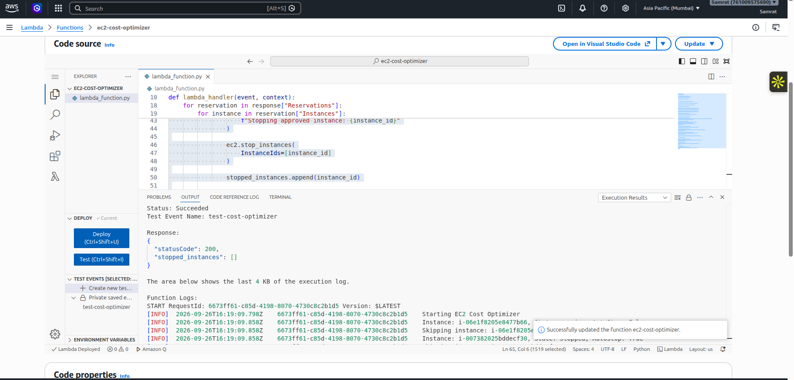
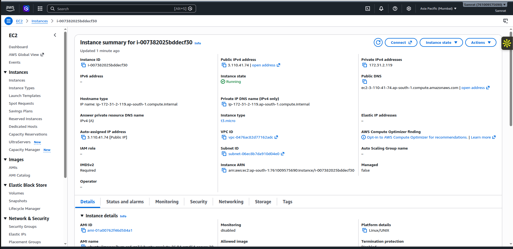
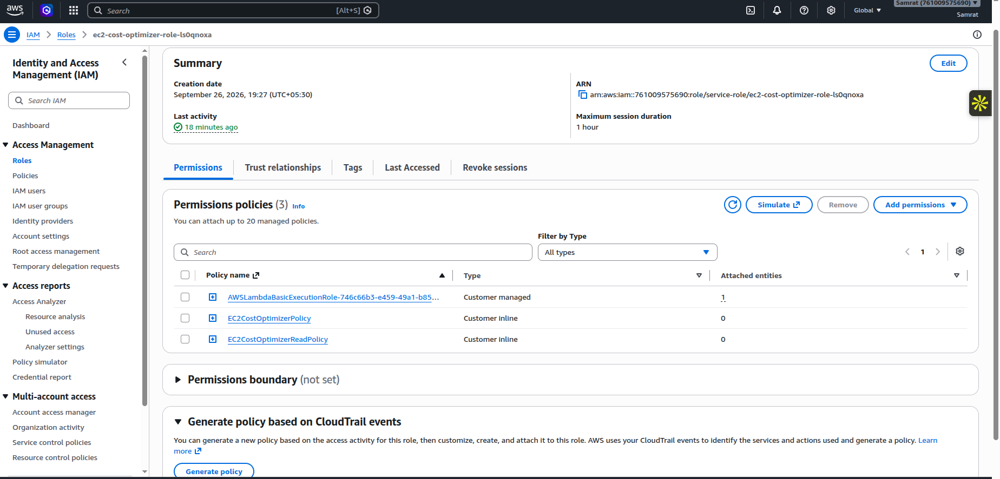
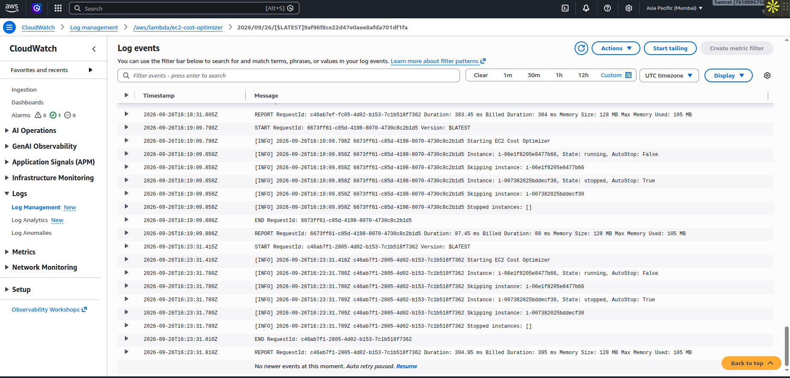
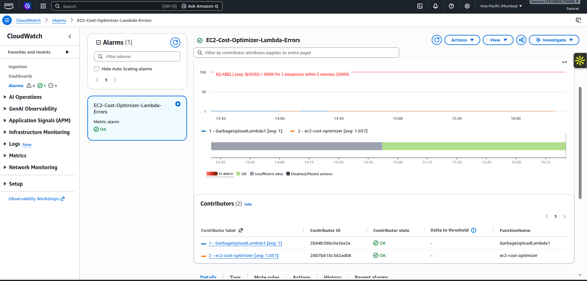
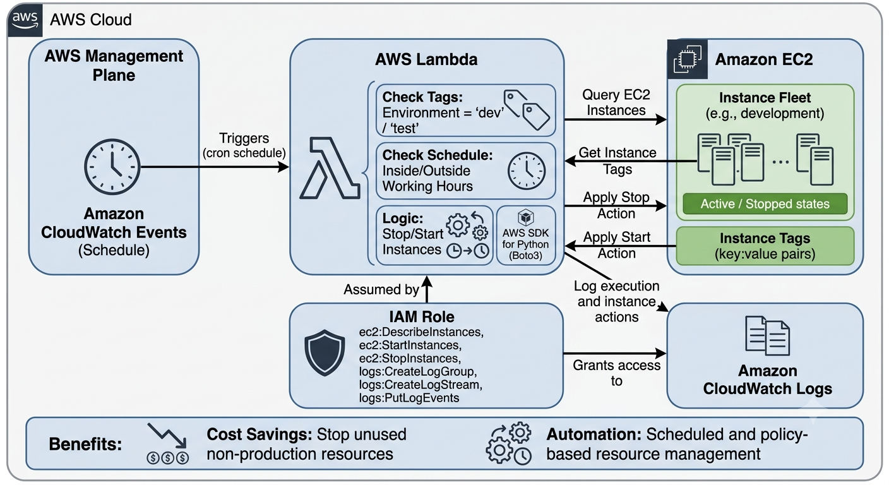

# Automated AWS Cost Optimizer

This project automatically stops EC2 instances that are tagged with `AutoStop=true`, helping reduce unnecessary compute costs during idle or off-hours periods.

## What it does

The AWS Lambda function:

- Lists all EC2 instances in the current account/region
- Checks each instance for the `AutoStop` tag
- Stops any instance whose tag value is exactly `true`
- Skips instances that are already stopped or not tagged for auto-stop
- Logs all actions for auditing and troubleshooting

## AWS Services
-Amazon Lambda
-Amazon EC2 (Elastic Compute Cloude)
-Amazon IAM
-Amazon CloudWatch
-Amazon CloudWatch Alarm








## Architecture
- AWS Lambda runs the optimizer logic
- Amazon EC2 provides the target compute resources
- Amazon EventBridge can trigger the Lambda on a schedule
- IAM permissions allow DescribeInstances and StopInstances actions


## Result


## Example instance tag

Add this tag to any EC2 instance you want the optimizer to stop automatically:

- Key: `AutoStop`
- Value: `true`

## Deployment

### Prerequisites

- AWS CLI configured with valid credentials
- AWS SAM CLI installed
- Python 3.12 or compatible runtime

### Package and deploy

```bash
sam build
sam deploy --guided
```

When prompted, set the stack name, AWS region, and confirm the changes. The template creates the Lambda function and the scheduled trigger.

## Schedule configuration

The default schedule is configured in `template.yaml` using a cron expression. You can change it to match your business hours or maintenance windows.

Example:

```yaml
Schedule: cron(0 18 ? * MON-FRI *)
```

This example runs at 6:00 PM UTC Monday through Friday.

## Local validation

You can run a quick syntax check for the Lambda code:

```bash
python -m py_compile lambda_function.py
```

## Files

- `lambda_function.py` – Lambda entry point and optimization logic
- `template.yaml` – SAM deployment template
- `requirements.txt` – Python dependencies

## Notes

- The function only stops instances that explicitly opt in with the `AutoStop=true` tag.
- It is designed as a cost-saving automation and should be reviewed carefully before broad production use.
- For production workloads, validate the schedule against business requirements and maintenance windows.


## Key Learning
AWS Lambda: Learned how to write a serverless Python function that automatically performs AWS resource-management tasks.
Amazon EC2: Learned how to identify EC2 instances, check their state, read tags, and stop selected instances programmatically.
Boto3: Gained practical experience using Python and the AWS SDK to interact with EC2.
IAM: Learned how to follow the principle of least privilege by giving Lambda only the required permissions such as DescribeInstances and StopInstances.
Amazon CloudWatch: Learned how to monitor Lambda execution, view logs, and troubleshoot automation.
CloudWatch Alarms: Learned how monitoring can be used to detect conditions that require attention.
Tag-based automation: Learned how tags such as AutoStop=true can be used to safely select resources for automation instead of affecting every EC2 instance.
Cost optimization: Understood how scheduled stopping of eligible non-production/idle EC2 instances can help reduce unnecessary compute usage.
AWS SAM: Learned how template.yaml, sam build, and sam deploy --guided can be used to define and deploy serverless infrastructure.
Logging & troubleshooting: Learned the importance of logging actions such as which instances were detected, skipped, or stopped.
Infrastructure automation: Understood how multiple AWS services can work together to create an automated cloud-management workflow.